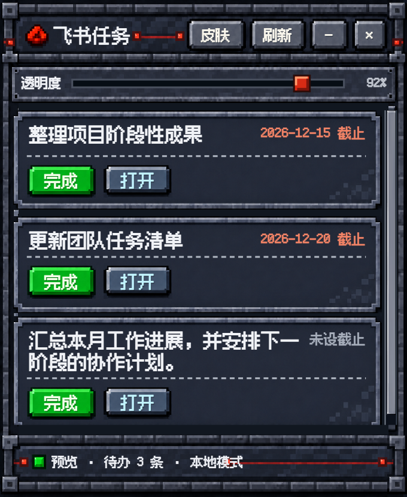

# 飞书像素任务 · Feishu Pixel Tasks

适用于 Windows 的 MC 灵感像素风任务悬浮窗。提供 **草方块 / 原木** 与 **深板岩 / 红石** 两套皮肤，内置中文像素字体。

基于原 PowerShell + WebView2 原型改造：保留飞书任务字段、`lark-cli` 同步接口与任务深链接，桌面宿主改为 C# / WinForms / WebView2，网络操作异步执行。




## 下载与启动

1. 打开 [Releases](https://github.com/DYWINWEN/feishu-pixel-tasks/releases/latest)。**Windows 11 64 位请选择 `FeishuPixelTasks-win-x64.zip`**；另提供 `win-x86` 32 位兼容构建。
2. 完整解压压缩包，双击 `FeishuPixelTasks.exe`。不要只复制 EXE，`Web`、字体及运行库需要一起保留。
3. 包含 .NET 运行时，无需自行安装 .NET 或 PowerShell 模块。需要 [Microsoft Edge WebView2 Runtime](https://developer.microsoft.com/microsoft-edge/webview2/#download-section)；Windows 11 通常已有，缺失时请从微软安装。
4. 首次启动为本地模式、空任务列表。点击左上角方块图标或底部状态栏打开「任务工具」，可新建任务、筛选已完成任务或进入设置连接飞书。

目标环境是 Windows 11 x64；x86 是应用进程架构，**不代表支持 Windows 7/8**。发布包目前未进行商业代码签名。

## 功能

- 两套根据设计稿制作的去字像素材质底图与内嵌 Fusion Pixel 中文字体，离线可用。边框、图标、木纹、石纹及按钮高光用九宫格纹理绘制，文字和操作仍是真实可访问控件。
- 任务新增、编辑、删除、完成与恢复；待办/已完成筛选；可选截止日期与网页链接。
- 飞书待办刷新、一键完成、失败保留、显式重试/取消重试；所有网络调用在后台异步执行。
- 40–100% 窗口透明度、置顶、拖动、折叠、右下角缩放；最小化入口位于任务工具菜单，也可通过 Windows 任务栏操作。
- 任务与偏好本地持久化，写入采用临时文件替换并保留上一份 `.bak`。
- 兼容旧版 `tasks_snapshot.json` 的导入；导出任务 JSON 不包含凭据。
- `F5` 刷新，`Ctrl+N` 新建任务，Tab/Enter 键可操作按钮与表单。

### v1.1 设计稿还原

以约 1107 × 1421 的两张像素字体设计稿为基准，重新标定标题栏、透明度、卡片、按钮、日期字号及底栏比例，窗口默认尺寸调整为 680 × 873。主界面只保留设计稿中的控件；任务工具可从左上角图标或底栏打开，右键任务可编辑或删除，鼠标悬停也有快捷按钮。无关联网址的本地任务点击「打开」进入任务详情。

材质底图不包含任务文字、日期或凭据。标题和日期等内容仍使用真实像素字体动态排版，因此与生成图中的手绘字形存在细微差别；不同任务长度、窗口大小和滚动状态会产生正常的布局变化。这里的还原不意味着所有屏幕、所有内容都与静态设计图逐像素相同。

## 飞书接入：沿用原程序的 lark-cli

原程序依赖 **豆包/LarkShell 会话提供的 `lark-cli` 和有效会话凭据**。本项目保留该连接方式，**不内置飞书账户、令牌、CLI 二进制，也不自动续期第三方会话凭据**。

1. 在原电脑确认可运行 `lark-cli.exe`，并拥有对应飞书账户的任务权限。
2. 打开应用「设置」，选择「连接飞书（lark-cli）」，填写完整路径或用「浏览」选择 `lark-cli.exe`。如果 CLI 已在 `PATH` 上可保留 `lark-cli`。
3. 已登录 CLI 的环境可直接使用；如果原环境依赖 `lark_token.json`，在本机点击「导入凭据」选择它。支持 `DOUBAO_OFFICE_CLI_TOKEN`、`DOUBAO_OFFICE_USER_ACCESS_TOKEN` 字段。原文件不会上传。导入后的副本使用 Windows DPAPI 按当前用户加密，仅在启动 CLI 子进程时解密注入环境。
4. 保存设置后点击「刷新」。状态栏显示真实同步时间或错误，成功前不显示已同步。可以开启每 5 分钟自动同步。
5. 飞书任务点击「完成」并确认后进入持久化队列。飞书确认成功才移除；失败保留并显示重试次数，不会尝试几次后静默丢弃。飞书任务的编辑和删除请通过「打开」进入飞书进行。

实际调用保留原程序命令：

```text
lark-cli task +get-related-tasks --include-complete=false --page-all
lark-cli task +complete --task-id <guid>
```

期望 CLI 标准输出为 JSON：读取结果 `{ "ok": true, "data": { "items": [...] } }`，完成结果 `{ "ok": true }`。标准错误并行读取；超时 45 秒；不将原始输出或令牌写入界面/日志。命令参数分开传递，不拼接 shell 命令。

**凭据过期时需要在原环境更新后重新导入。** 本项目不会读取其他软件的私有目录来寻找或刷新凭据。真实账号联调需要在持有有效 CLI 登录的 Windows 电脑上完成；仓库自动化测试使用模拟接口，不操作个人飞书任务。

### 从旧程序迁移

打开「设置 → 导入旧版任务」，选择旧目录中的 `tasks_snapshot.json`。导入的是**本地副本**，不会自动提交旧 `pending_actions.json` 里的动作。直接连接飞书并刷新则加载真实飞书待办；两者会同时保留，所以避免把同一批数据既导入又同步后误认为没有重复。

任务导出保留标题、日期、状态和链接。重新导入时生成新的本地 ID；它不是完整账户/设置备份。旧版令牌文件如仍需要，请仅通过「导入凭据」在本机选择。

## 数据保存位置

```text
%LOCALAPPDATA%\FeishuPixelTasks\
  state.json              # 任务、待重试动作、偏好
  state.json.bak          # 上一次保存的备份
  credentials.secret     # DPAPI 加密凭据（可在设置中清除）
  WebView2\               # 浏览器运行配置
```

任务文件损坏时会报错并保留原文件，不会悄悄重置为空。恢复前退出应用、复制整个目录作备份，再将已确认正常的 `.bak` 复制为 `state.json`。

应用不包含遥测。界面不会向远程站点请求字体或脚本；所有任务文本通过 `textContent` 渲染。外部链接只允许 HTTP/HTTPS。打开链接由系统默认浏览器处理；原有飞书 applink 可以继续唤起飞书客户端。

## 开发与构建

使用 [.NET 10 SDK](https://dotnet.microsoft.com/download/dotnet/10.0)。在 Windows PowerShell 中：

```powershell
dotnet run --project src/FeishuPixelTasks
./scripts/build.ps1 -Runtime win-x64
./scripts/build.ps1 -Runtime win-x86
```

可以在 macOS/Linux 上交叉编译；真正的桌面程序需要 Windows 运行：

```sh
dotnet publish src/FeishuPixelTasks/FeishuPixelTasks.csproj -c Release -r win-x64 --self-contained true -o dist/win-x64
```

浏览器预览（Node.js 22+）：

```sh
npm ci
npm run preview
# http://127.0.0.1:4317
```

浏览器预览内置虚构任务，仅提供本地交互。窗口透明度、置顶、文件选择、CLI 同步等原生能力需要 Windows 应用。它与桌面共用完全相同的 HTML/CSS/JS，不是另外一套展示页面。

## 验证

```sh
dotnet run --project tests/Core.Tests -c Release
npm ci
npx playwright install chromium
npm test
```

测试覆盖本地任务持久化、缓存保留、重复完成去重、远程确认与刷新失败顺序、队列重试、损坏文件保护、链接限制、前端文本注入、两套皮肤、窄窗口长任务和桌面消息桥。

GitHub Actions 在 Windows 为 x64/x86 分别构建，并启动实际 EXE，检查 WebView2 初始化、中文字体加载、三张任务卡渲染和横向溢出，输出两套皮肤的原生截图。浏览器测试在独立作业运行。推送 `v*` 标签后，所有作业通过才会发布 ZIP 和 SHA-256 校验文件。

原生冒烟测试命令：

```powershell
./FeishuPixelTasks.exe --smoke-test C:\Temp\pixel-smoke
```

这使用独立的测试数据目录，不触碰真实任务或凭据。界面截图与构建验证不等于真实飞书账户联调。

## 目录

```text
src/FeishuPixelTasks/       Windows 宿主、凭据加密、Web 界面
src/FeishuPixelTasks.Core/  数据存储、同步、lark-cli 适配
tests/Core.Tests/          无第三方测试框架的业务回归测试
tests/ui/                  Playwright 交互与布局测试
scripts/                   构建和本地预览脚本
```

代码采用 MIT 许可证。字体与第三方库许可证见 [THIRD-PARTY-NOTICES.md](THIRD-PARTY-NOTICES.md)。项目与 Mojang、Minecraft、飞书官方无隶属关系。
